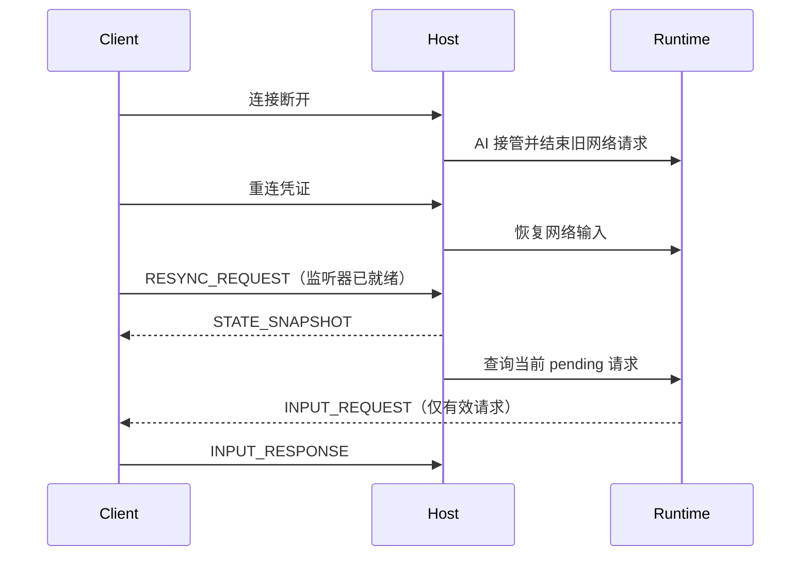

# 网络重连行动恢复设计

## 1. 目标与已确认行为

本设计解决联机对局中客机断线后重连成功、但无法继续操作的问题。

已确认的产品行为：

- 客机断线后，房主立即让对应座位由 AI 接管。
- 不暂停或恢复断线前旧的网络输入协程。
- 客机重连后必须获得房主最新的对局快照。
- 客机完成输入监听器初始化后，服务器必须补发当前仍有效的输入请求。
- AI 已经消费或结束的旧请求不重放，避免重复执行动作。

## 2. 当前问题

当前网络输入请求是瞬时消息：

1. 房主向客机发送 `INPUT_REQUEST`。
2. 客机收到消息后写入 `NetClientInput._active_requests`。
3. 客机断线时，房主调用 `NetworkPlayerInput.abort_pending()`，旧网络协程结束，座位切换到 AI。
4. 客机重连时，服务器发送状态快照，但快照只包含游戏状态，不包含当前输入请求。
5. 客机重建场景并创建新的 `NetClientInput` 后，之前发送的 `INPUT_REQUEST` 无法恢复。

此外，重连消息和新场景输入监听器之间存在时序窗口：输入请求可能在监听器连接前发送并丢失。

## 3. 设计方案

### 3.1 快照与请求恢复分离

`STATE_SNAPSHOT` 继续只表示权威游戏状态。不要把 Godot 对象或完整输入上下文直接塞入快照。

客机完成 `NetClientInput.attach()` 后主动发送已有的 `RESYNC_REQUEST`。服务器按以下顺序处理：

1. 发送当前 `STATE_SNAPSHOT`。
2. 查询重连玩家当前仍有效的 pending 网络输入请求。
3. 用原请求 ID 和请求 payload 补发 `INPUT_REQUEST`。

这样客户端只有在输入监听器准备好之后才依赖输入请求消息。

### 3.2 pending 请求记录

`NetworkPlayerInput` 的 pending 状态保存：

- request ID；
- seat ID；
- request type；
- 原始 payload；
- 请求是否已经收到响应。

服务器只重发以下请求：

- 请求仍在 `NetworkPlayerInput._pending` 中；
- 请求尚未收到响应；
- 请求对应的座位仍由重连玩家控制；
- 请求所属的 `NetworkPlayerInput` 仍是当前玩家输入对象。

以下情况不重发：

- 断线前旧网络输入请求，因为它已经被 AI 接管并结束；
- 已收到响应的请求；
- 玩家已经离开或座位已经转为 AI；
- 旧的、被新请求替换的请求。

### 3.3 请求幂等性

- 原 request ID 保持不变，客户端通过现有 seat 请求替换逻辑去重。
- 重复 `RESYNC_REQUEST` 不创建新规则请求，只会再次发送当前 pending 请求。
- 服务端仍通过 request ID 和 seat ownership 校验响应。
- 客户端重复收到同一个请求时，旧请求被同座位的新消息替换，不会产生两个可操作请求。

### 3.4 断线期间的 AI 接管

断线时继续沿用当前逻辑：

```text
断线
  -> abort 网络输入 pending
  -> 释放等待中的规则协程
  -> 座位转为 AI
  -> AI 继续当前行动
```

重连时：

```text
重连成功
  -> 座位恢复为 human
  -> 为座位创建新的 NetworkPlayerInput
  -> 客机完成监听器初始化
  -> RESYNC_REQUEST
  -> 快照 + 当前有效请求
```

如果 AI 已经完成当前行动，服务器只发送最新状态；下一次网络输入请求正常发送给客机。

## 4. 时序



## 5. 测试矩阵

| 场景 | 断线时行为 | 重连后预期 |
| --- | --- | --- |
| action 请求期间 | 旧请求转 AI | 最新状态可见，下一次 action 可操作 |
| choose_target 请求期间 | 旧目标选择转 AI | 后续目标选择可操作，旧请求不重复 |
| confirm 请求期间 | 旧确认转 AI | 后续确认请求可操作 |
| 动画期间 | 只同步状态/演出，不等待 ACK | 动画结束后的下一次请求可操作 |
| AI 已完成当前行动 | 不恢复旧协程 | 快照反映最新状态，下一请求不丢失 |
| 重复 RESYNC_REQUEST | 不创建新规则请求 | 同一 pending 请求可安全补发 |
| 过期/已响应请求 | 不重发 | 客户端不会出现错误操作入口 |

## 6. 不在本次范围内

- 不把旧 AI 协程切回网络输入。
- 不把动画类 `GAME_EVENT` 转换为需要 ACK 的输入请求。
- 不改变重连凭证、昵称认回和座位所有权策略。
